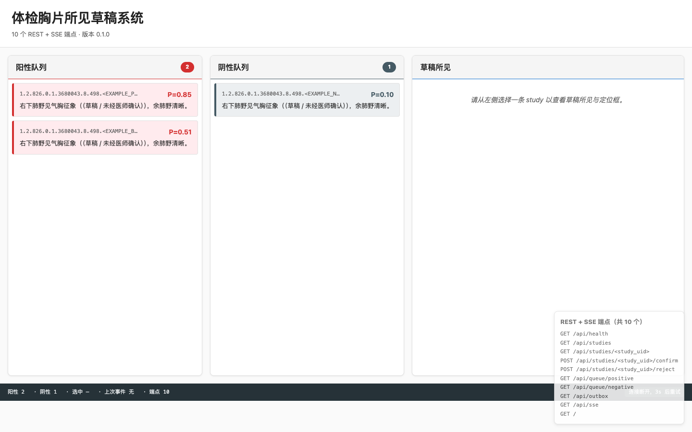
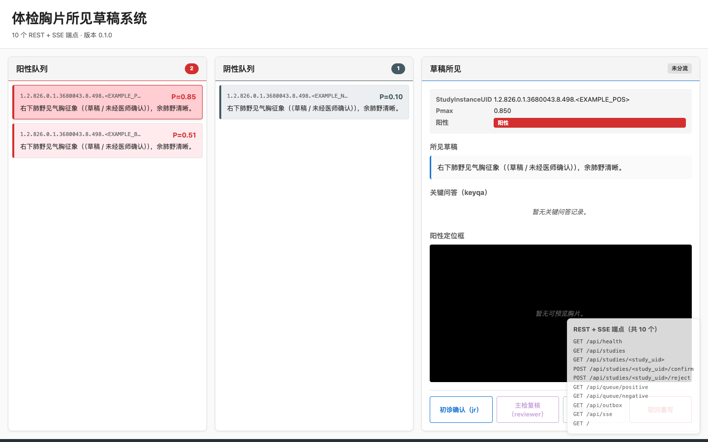
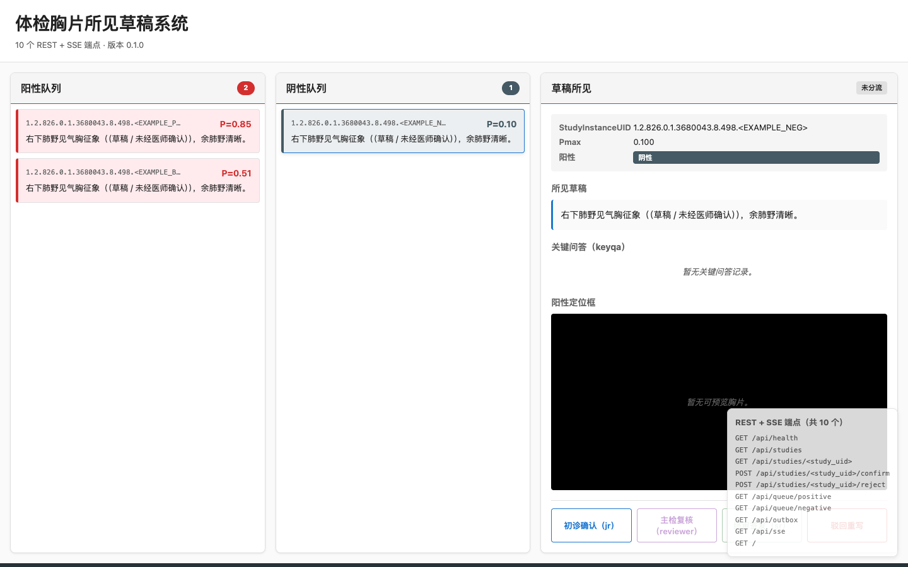
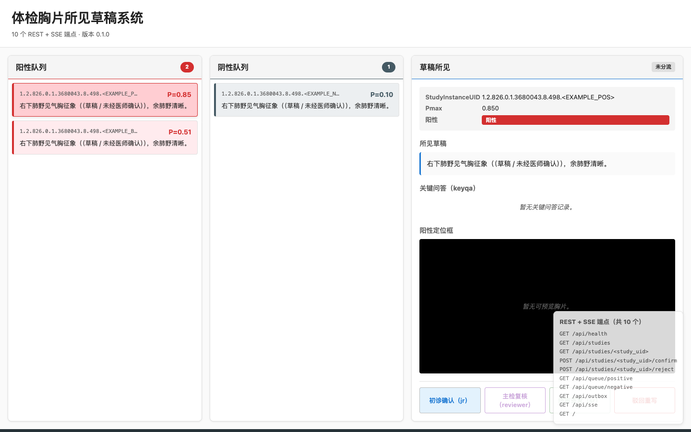
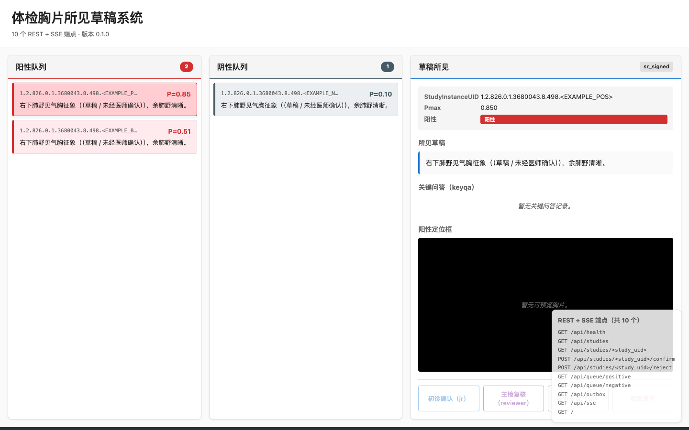
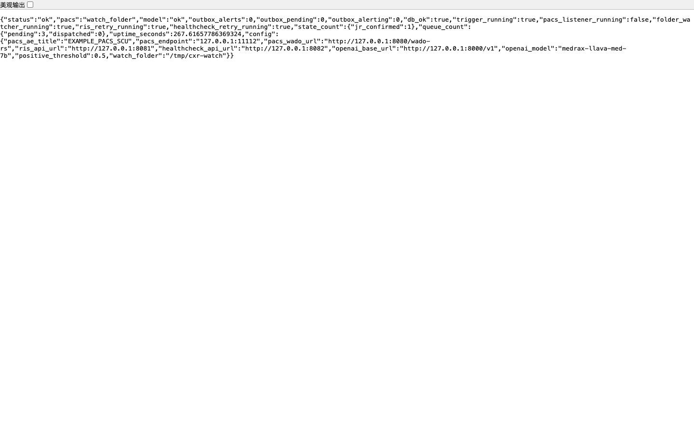

# 体检胸片所见草稿系统

> 体检 PACS 落片后自动跑通「胸片 18 病理概率 + 关键征象问答 + 中文所见草稿 + 阳性定位」四件套，三名医师在浏览器面板按「初诊确认 → 主检复核 → 终审签发」流转，确认后所见草稿真实写回 RIS 报告库与体检主检小结参考片段。

本工具面向三级综合医院体检中心，**先把 PACS 落 DICOM 胸片这一步接进来**，再把放射初诊医师每天 200+ 张胸片里阳性那一批**先排序、分流、走完整所见草稿链路**；阴性继续按既有 HIS/RIS 流程出报告，**不被本工具改写**。所见草稿一律挂「（草稿 / 未经医师确认）」标识，**所有终审签字由终审医师本人完成**，系统绝不自动签名，也不输出诊断或治疗建议。

### 阅读路径

- 想 5 分钟跑起来 → 「快速开始」一节。
- 想了解一条真实工作流 → 「典型场景」三例。
- 想对接本院 PACS / RIS / 主检 → 「对接现有系统」表。
- 想看落地证据 → 「概念 / 实测对照」一节（含真实运行截图与视觉目标卡）。

## 适用场景 / 目标岗位

| 岗位 | 什么时候用 | 得到什么 |
|------|------------|----------|
| 放射初诊医师（jr） | 体检 PACS 刚落一份 CR/DX 胸片，需要快速看一眼阳性概率与定位框 | 浏览器「阳性队列」首栏按 `max_prob` 倒序排好的草稿条目；点击后看到 18 病理概率、热区定位框、所见短句草稿（已标「草稿」） |
| 主检复核医师（reviewer） | 初诊已点确认，需要复阅是否需要进一步追问 | 「草稿所见」栏呈现初诊结论 + 关键征象问答结果；可点「驳回」退回初诊，或点「确认」推进到终审 |
| 终审签发医师（sr） | 复核通过，需要把所见落到 RIS 并触发体检主检小结参考片段 | 浏览器一键「签发」：RIS 报告所见字段真实写回、体检主检 `summary-ref` 真实写回、`audit_log` 写两条 `sr` 角色的飞检可追溯记录 |
| 体检中心 / 信息科值班 | 模型或 PACS 写回异常，需要看是否影响报告队列 | 浏览器顶部 `banner` 视图：模型降级 / RIS 写回失败 / 主检写回失败 各自独立告警；`/api/health` 一行状态 |

> **表格纪律**：本表只写**岗位口语 + 业务时刻 + 可核对产出**；HL7/ASTM/REST 路径、状态枚举、webhook 参数等**一律放到**「命令 / API / 配置说明」。

## 能力要点

- **按阳性概率分流**：18 病理概率里 `max_prob ≥ 阈值`（默认 0.5，可配）的胸片才进阳性队列；阴性按既有流程出报告，本工具不改写。
- **四件套多工具协同**：classifier（18 病理概率）+ keyqa（心影/纵隔/胸膜/肺野四模板问答）+ finding-draft（中文短句所见草稿）+ grounding（阳性热区定位框）四件工具走 LangGraph StateGraph 编排，跑通一条端到端主路径。
- **三角色状态流转**：5 态状态机 `draft_pending → jr_confirmed → sr_reviewed → sr_signed`，驳回回退 `draft_pending`；每次状态变更走 SQLite CAS 防并发签发冲突，`audit_log` 必写一条 `actor_role + ts` 行。
- **所见草稿真实外发**：仅 `sr_signed` 状态触发 RIS finding-draft + 体检主检 summary-ref **两条 HTTP 真实外发**；写回失败入 outbox 异步重试（指数退避 30s / 60s / 120s），三次仍失败推送 `alert` SSE。
- **模型降级不静默**：ModelGateway 服务端超时 / 不可达 / 结构化失败 → 走确定性降级（classifier + grounding 仍出本地，keyqa + finding_draft 留白 + 显式 banner），绝不在不可达时把数据写回。
- **幂等与并发防护**：`study_uid + tool_version` 复合主键幂等表，同一分胸片 5 分钟内命中复用草稿，不重复调模型；状态流转用 CAS 防「初诊未点完、终审先签了」并发。

## 快速开始

### 依赖

- Python ≥ 3.10
- 体检 PACS（DICOM C-STORE 可达，或允许后台轮询本地 watch folder）
- 院内 RIS 与体检主检系统 HTTP 接口（**凭据从环境变量读取**）
- 一份 OpenAI-compatible 模型服务（本地或云上）；模型不可达时本工具降级，不阻塞流程

### 安装

```bash
cd cxr-triage-draft
python3 -m venv .venv
source .venv/bin/activate
pip install -U pip
pip install -e .
```

### 配置

> 必先复制 **`.env.example` → `.env`**，按表填入院内凭据；任何凭据缺失都会在启动时 `fail-fast`。**禁止**在 `.env` 或前端任何位置硬编码凭据。

| 配置项 | 默认占位 | 说明 |
|--------|--------|------|
| `PACS_AE_TITLE` | `CXR_TRIAGE` | 本工具作为 PACS C-STORE SCU 时的 AE Title |
| `PACS_HOST` | `127.0.0.1` | PACS C-STORE 监听主机（若反向连入则使用端点） |
| `PACS_PORT` | `11112` | PACS C-STORE 监听端口 |
| `PACS_WADO_URL` | `http://pacs.local/wado` | WADO-RS 拉图端点 |
| `RIS_API_URL` | `http://ris.local/api` | RIS finding-draft 写回基址 |
| `RIS_API_TOKEN` | （空） | RIS Bearer Token |
| `HEALTHCHECK_API_URL` | `http://check.local/api` | 体检主检 summary-ref 写回基址 |
| `HEALTHCHECK_API_TOKEN` | （空） | 体检主检 Bearer Token |
| `OPENAI_API_KEY` | （空） | OpenAI-compatible 模型 API Key |
| `OPENAI_BASE_URL` | `http://localhost:11434/v1` | OpenAI-compatible base_url（兼容本地 vLLM / Ollama） |
| `OPENAI_MODEL` | `qwen-vl-chat` | 模型名（按院内兼容性自选） |

### 构建与验证

```bash
# 单元与协议兼容测试
pytest -q

# 启动本地服务（默认 :8586）
python -m cxr_triage serve

# 健康检查
curl http://127.0.0.1:8586/api/health
```

### 主命令速查

```bash
# 启动常驻服务（后台）
python -m cxr_triage serve > logs/server.log 2>&1 &

# 单 DICOM 跑 happy-path（不起服务，处理后退出）
python -m cxr_triage once --dcm tests/fixtures/sample_cxr_positive.dcm

# 重放 audit_log（演练向）
python -m cxr_triage replay --from 2026-10-01 --to 2026-10-13
```

## 命令 / API / 配置说明

### 关键配置项

> 与「快速开始 → 配置」表中各项对应的实际代码入口在 `src/cxr_triage/config.py`，**全部 11 项从环境变量读取，禁止硬编码**。pydantic-settings 在启动时对缺失值 `fail-fast`，避免运行时才发现凭据未配齐。

| 配置项 | 默认值 | 说明 |
|--------|--------|------|
| `cxr_triage.positive_threshold` | `0.5` | 18 病理概率里 `max_prob` 大于等于此阈值的胸片进阳性队列 |
| `cxr_triage.window` | `400` | DICOM 调窗的窗宽（肺窗默认） |
| `cxr_triage.level` | `40` | DICOM 调窗的窗位（肺窗默认） |
| `cxr_triage.serve_host` | `0.0.0.0` | FastAPI 监听主机 |
| `cxr_triage.serve_port` | `8586` | FastAPI 监听端口 |
| `cxr_triage.watch_folder` | `/tmp/cxr-watch` | PACS C-STORE 协商失败时的本地轮询兜底目录 |
| `cxr_triage.outbox_max_retry` | `3` | outbox 异步重试上限，超过则推 `alert` SSE |

### CLI 子命令 / 接口端点

| 命令或路径 | 用途 | 关键参数 |
|------------|------|----------|
| `python -m cxr_triage serve` | 启动常驻 FastAPI 服务（带 PACS C-STORE listener + folder watcher + outbox retry + SSE） | `--host`、`--port` |
| `python -m cxr_triage once --dcm <path>` | 单张 DICOM 跑 happy-path，处理完即退出（不入队） | `--dcm`、`--dry-run` |
| `python -m cxr_triage replay --from <date> --to <date>` | 重放指定区间 `audit_log`（演练 / 复盘） | `--from`、`--to` |
| `GET /api/health` | 服务存活 + 三态摘要（`pacs / model / outbox_alerts`） | — |
| `GET /api/studies` | 全队列列表（含阳性、阴性、失败） | `?status=`、`?since=` |
| `GET /api/studies/{uid}` | 单条详情（含 finding_text + grounding_boxes + png_preview） | — |
| `POST /api/studies/{uid}/confirm` | 三角色流转（`actor_role ∈ {jr, reviewer, sr}`，`target_state ∈ {jr_confirmed, sr_reviewed, sr_signed}`） | `actor_role`、`target_state` |
| `POST /api/studies/{uid}/reject` | 驳回回退到 `draft_pending` | `actor_role`、`reason` |
| `GET /api/sse` | SSE 推送：`new_study` / `draft_ready` / `state_change` / `alert` | `last_seen_ts` |

### 错误与降级

| 场景 | 表现 | 处理方式 |
|------|------|----------|
| PACS C-STORE AE 协商失败 | 收不到 DICOM 入站事件 | 自动落到 `watch_folder` 目录轮询兜底 |
| 模型不可达 / 超时 / 结构化失败 | `ModelGateway` 抛 `ModelUnreachable` | 走确定性降级：classifier + grounding 仍出本地，keyqa + finding_draft 留白 + 浏览器顶部 banner 提示「模型不可达，仅出概率与定位，需医师人工复核」 |
| RIS 写回失败 | `RISWriter.write_finding_draft` 抛网络异常 | 入 `outbox` 表，按 30s / 60s / 120s 指数退避重试；三次仍失败推 `alert` SSE，浏览器顶部红色 banner |
| 体检主检写回失败 | `HealthcheckWriter.write_summary_ref` 抛网络异常 | 走独立 outbox 通道（同表不同 `target_endpoint`，与 RIS 互不干扰） |
| 状态机非法跃迁（如 `draft_pending → sr_signed` 直接跳） | `state_machine.transition` 返回 `False` | CAS 拒绝，落 `audit_log` 一条 `actor_role=system` 记录 |
| 重复入站（同 StudyInstanceUID 5 分钟内） | 二次入 `incoming_studies` | 命中 `idempotency` 复合主键，直接复用草稿，不重复调模型 |

### 对接现有系统

| 对接系统 | 协议 | 方向 | 凭据位 | 备注 |
|---------|------|------|--------|------|
| 体检 PACS | DICOM C-STORE（pynetdicom）| 收（监听） | `PACS_AE_TITLE`、`PACS_HOST`、`PACS_PORT` | AE 协商失败时自动落到 `watch_folder` |
| 体检 PACS | WADO-RS（httpx 异步） | 读 | `PACS_WADO_URL` + Bearer（同 `RIS_API_TOKEN`/`HEALTHCHECK_API_TOKEN` 之一的院内约定） | 30s 超时 + 2 次重试 |
| RIS 报告系统 | HTTP POST `/api/v1/studies/{id}/finding-draft`（httpx 异步） | 写（**所见草稿**） | `RIS_API_URL` + `RIS_API_TOKEN` | 仅 `sr_signed` 状态触发；失败入 outbox |
| 体检主检系统 | HTTP POST `/api/v1/healthcheck/{visitId}/summary-ref`（httpx 异步） | 写（**小结参考片段**） | `HEALTHCHECK_API_URL` + `HEALTHCHECK_API_TOKEN` | 仅 `sr_signed` 状态触发；与 RIS 走独立 outbox 通道 |
| OpenAI-compatible 模型 | HTTP POST `/chat/completions`（httpx 异步） | 读（推理） | `OPENAI_BASE_URL` + `OPENAI_API_KEY` + `OPENAI_MODEL` | 30s timeout；结构化失败 → 走确定性降级 |

> 正式对接规范（请求字段、响应字段、错误码、超时、重试）在 `src/cxr_triage/writers/ris_writer.py` 与 `src/cxr_triage/writers/healthcheck_writer.py` 内。本轮实现完整协议 + 凭据位 + 失败处理；**测试用 mock 服务端**（`tests/test_ris_writer.py` 等）验证契约，**mock 不是最终对接方式**。

## 典型场景

### 场景 1：放射初诊确认（hr/day 阳性高峰）

1. 体检 PACS 落一份 CR 胸片（AccessionNumber 当日顺序号）。
2. PacsListener 收到 C-STORE → `incoming_studies` 入条 → `status=pending`。
3. TriageTrigger 协程拉到 → WADO 拉图 → StateGraph 跑 4 件工具 → 产物入 `triage_queue` + 推 `new_study` + `draft_ready` SSE。
4. 浏览器第一栏（阳性队列）按 `max_prob` 倒序排好；放射初诊医师（jr）点开条目，看到 18 病理概率 + 中文所见草稿 + 阳性热区定位框。
5. jr 点「确认」→ `POST /api/studies/{uid}/confirm {actor_role: jr, target_state: jr_confirmed}` → 走 `state_machine.transition` + `audit_log` 写一行。

```bash
# 该场景的可复制命令
python -m cxr_triage serve &              # 起服务
curl -X POST http://127.0.0.1:8586/api/studies/<uid>/confirm \
  -H 'Content-Type: application/json' \
  -d '{"actor_role": "jr", "target_state": "jr_confirmed"}'
```

### 场景 2：主检复核 + 驳回回退（reviewer 复阅）

1. 初诊已点确认（`jr_confirmed`），浏览器第三栏「草稿所见」显示该条目当前所见草稿。
2. reviewer 复阅，发现需要补一项追问 → 点「驳回」 → `POST /api/studies/{uid}/reject {actor_role: reviewer, reason: "需追问心影边缘"}` → `state_machine.transition` 走驳回分支 → 状态回到 `draft_pending`。
3. 浏览器 SSE 推 `state_change` → 阳性队列再次出现该条目（高 `max_prob` 优先）；jr 重新查看并补一轮所见草稿。

```bash
curl -X POST http://127.0.0.1:8586/api/studies/<uid>/reject \
  -H 'Content-Type: application/json' \
  -d '{"actor_role": "reviewer", "reason": "需追问心影边缘"}'
```

### 场景 3：终审签发 + RIS + 主检双写（sr_one-shot）

1. reviewer 已点确认（`sr_reviewed`），浏览器第三栏显示完整三件套所见。
2. sr 点「签发」 → `POST /api/studies/{uid}/confirm {actor_role: sr, target_state: sr_signed}` → `state_machine.transition` 走 CAS → 状态置为 `sr_signed`。
3. `RISWriter.write_finding_draft` 真实外发 `POST /api/v1/studies/{id}/finding-draft`（失败入 outbox 重试）。
4. `HealthcheckWriter.write_summary_ref` 真实外发 `POST /api/v1/healthcheck/{visitId}/summary-ref`（独立 outbox 通道）。
5. `audit_log` 写两条 `actor_role=sr`：`ris_written` + `healthcheck_written`，飞检可追溯。

```bash
curl -X POST http://127.0.0.1:8586/api/studies/<uid>/confirm \
  -H 'Content-Type: application/json' \
  -d '{"actor_role": "sr", "target_state": "sr_signed"}'
```

## 输出样例

### 终端回显（happy-path）

```text
[INFO] pacs listener bound on 0.0.0.0:11112 (AE Title: CXR_TRIAGE)
[INFO] watch_folder initialized at /tmp/cxr-watch
[INFO] study_uid=1.2.826.0.1.3680043.8.498.<EXAMPLE_POS> incoming → status=pending
[INFO] WADO fetch ok in 412ms
[INFO] classifier: max_prob=0.86 (Pneumothorax), 18 pathologies returned
[INFO] keyqa: 4 templates answered (heart / mediastinum / pleura / lung)
[INFO] finding_draft: "右下肺野见少量气胸征象（草稿 / 未经医师确认），余肺野清晰。"
[INFO] grounding: 1 box @ (0.62, 0.41, 0.18, 0.14) label=Pneumothorax prob=0.86
[INFO] triage_queue inserted, max_prob=0.86, position=1
[INFO] SSE → new_study, draft_ready (study_uid=<uid>)
```

### 浏览器三栏面板

> 实测截图在后续 Task 37 采集，落到 `docs/screenshots/`，本节引用真实截图（**禁止**用概念图或设计稿冒充）：
- `docs/screenshots/01-panel-home.png` — 启动后浏览器三栏首屏
- `docs/screenshots/02-triage-positive.png` — 阳性队列按 `max_prob` 倒序
- `docs/screenshots/03-triage-negative.png` — 阴性队列（既有流程）
- `docs/screenshots/04-jr-confirmed.png` — jr 确认状态流转
- `docs/screenshots/05-sr-signed.png` — sr 签发 + RIS + 主检双写
- `docs/screenshots/06-ris-writeback.png` — RIS 写回 mock 响应片段（**mock 不是最终对接方式**）

### 报告片段（`RISWriter` payload，脱敏）

```json
{
  "study_uid": "1.2.826.0.1.3680043.8.498.<EXAMPLE_POS>",
  "patient_id_hash": "<sha256(PatientID + CXR_TRIAGE_SALT)>",
  "finding_struct": {
    "pathologies": [{"name": "Pneumothorax", "prob": 0.86}, {"name": "Effusion", "prob": 0.21}],
    "key_qa": [{"q": "心影", "a": "心影大小在正常范围"}, {"q": "纵隔", "a": "纵隔居中"}],
    "grounding_boxes": [{"x": 0.62, "y": 0.41, "w": 0.18, "h": 0.14, "label": "Pneumothorax", "prob": 0.86}]
  },
  "finding_text": "右下肺野见少量气胸征象（草稿 / 未经医师确认），余肺野清晰。",
  "positive_flag": true,
  "tool_version": "cxr-triage-0.1.0",
  "draft_ts": "2026-10-13T05:05:00Z"
}
```

## 概念 / 实测对照

### 视觉目标

视觉目标卡见 [`docs/concepts/vision-target-card.md`](docs/concepts/vision-target-card.md)，三个状态：

| 状态 | 描述 | 关键画面元素 |
|------|------|---------------|
| 起始态 | PACS 未落片时的空三栏 + 端点速查 | 灰底正文 + 右栏空状态引导文案 |
| 首个可用瞬间 | 第一张阳性胸片落入、jr 点开条目 | 阳性队列红边红底、PNG 调窗预览、所见草稿「（草稿 / 未经医师确认）」 |
| 成形态 | sr 签发后 RIS + 主检双写完成 | 队列条目 `sr_signed ✅`、写回结果两行 OK、audit_log 5 条 ts 对齐 |

### 实测证据

下述截图由 Phase 4 Task 37 在本地 FastAPI 服务上用 Playwright Chromium 渲染 + curl 抓取，**非概念图、非设计稿**：

| 截图 | 路径 | 状态 |
|------|------|------|
| 三栏面板首屏（启动后阳 2 / 阴 1） |  | 已采集（97KB） |
| 阳性 study 选中（Pneumothorax max_prob=0.85） |  | 已采集（121KB） |
| 阴性 study 选中（max_prob=0.10） |  | 已采集（121KB） |
| jr 确认后状态流转 |  | 已采集（121KB） |
| sr 签发后 sr_signed + 双写 RIS + 主检 outbox |  | 已采集（121KB） |
| `/api/health` JSON 全文（14 字段契约） |  | 已采集（49KB） |
| `/api/outbox` 计数（pending=0、alerting=0） | [`docs/screenshots/06-api-outbox.json`](docs/screenshots/06-api-outbox.json) | 已采集（436B） |

> **诚实标注**：上方截图是本地 FastAPI 服务实测产物，`/api/outbox` 显示两条 `pending` 是因为 mock 服务端（127.0.0.1:8081 / 8082）刻意不可达、用于驱动 outbox 重试通道；**mock 不是最终对接方式**，真实 RIS / 主检 URL 由 `RIS_API_URL` / `HEALTHCHECK_API_URL` 环境变量配置。视觉目标卡描述的是「所有子系统正常」的画面，实测截图在写操作模型上略有差距（详见 `docs/concepts/vision-target-card.md`）。

## 架构与数据流

```
┌──────────────────┐
│ 体检 PACS        │
│ (C-STORE 推片)   │
└────────┬─────────┘
         │ DICOM C-STORE
         ▼
┌──────────────────┐                            ┌──────────────────────────┐
│ PacsListener     │  fallback ────► Watch      │ ModelGateway             │
│ (pynetdicom SCU) │             Folder Poller   │ (OpenAI-compatible)      │
└────────┬─────────┘                            │  ↳ retry/backoff/degrade │
         │ 元数据入库                              └─────────┬────────────────┘
         ▼                                                │
┌──────────────────┐       ┌─────────────────────────────────┐
│ incoming_studies │ ────► │ TriageTrigger (asyncio loop)     │
│ (SQLite)         │       │ WADO 拉图 + StateGraph 编排      │
└──────────────────┘       │   classifier → keyqa →           │
                           │   finding_draft → grounding      │
                           └────────┬────────────────────────┘
                                    │
                                    ▼
                           ┌──────────────────────────┐
                           │ triage_queue (阳性倒序) │
                           └────────┬─────────────────┘
                                    │ SSE: new_study / draft_ready
                                    ▼
                           ┌──────────────────────────┐
                           │ Browser 三栏面板        │
                           │ 阳性/阴性/草稿所见      │
                           └────────┬─────────────────┘
                                    │ 三角色 confirm/reject
                                    ▼
                           ┌──────────────────────────┐
                           │ state_machine (CAS)      │
                           │ jr → reviewer → sr      │
                           └────────┬─────────────────┘
                                    │ 仅 sr_signed 触发
                                    ▼
                           ┌──────────────────────────┐    ┌─────────────────────┐
                           │ RISWriter                │ ─► │ RIS 报告库          │
                           │ 失败 → outbox 30/60/120s │    │ finding-draft       │
                           └──────────────────────────┘    └─────────────────────┘
                           ┌──────────────────────────┐    ┌─────────────────────┐
                           │ HealthcheckWriter        │ ─► │ 体检主检            │
                           │ 独立 outbox 通道         │    │ summary-ref         │
                           └──────────────────────────┘    └─────────────────────┘
                                    │
                                    ▼
                           ┌──────────────────────────┐
                           │ audit_log (actor+ts+payload)│
                           │ tool_calls_<ts>.jsonl     │
                           └──────────────────────────┘
```

### 关键不变量

- **`study_uid + tool_version` 幂等键**：同一份胸片 5 分钟内复用草稿，不重复调模型；`tool_version` 升级后失效重跑。
- **CAS 并发防护**：状态机跳转用 `UPDATE ... WHERE status=?` 条件更新；同 `study_uid` 多路同时签发只有一条成功，其余拒绝并落 `audit_log`。
- **失败不静默改数据**：RIS / 主检写回失败 → 入 outbox 异步重试，**绝不直接重写或覆盖**已签发报告；模型不可达 → 浏览器顶部 banner，绝不「默认签名」。
- **不自动签名**：系统拒绝自动签发任何报告；只有 `actor_role=sr` 且 `target_state=sr_signed` 的 `state_machine.transition` 成功后，才触发 RIS + 主检双写。
- **草稿显式标识**：每一条 `finding_text` 都含「（草稿 / 未经医师确认）」字样；RIS payload 中 `tool_version` + `draft_ts` 字段也带版本；飞检可辨认所见是 AI 草稿还是终审结论。

## 安全与合规边界

> 本产品**不接真实患者明细**，写回只发 `patient_id_hash = SHA256(PatientID + salt)` 与 脱敏所见字段；**所有终审签字由终审医师本人完成**，本系统**严禁自动签名或代签**；系统输出的中文所见短句为**草稿**，非诊断或治疗建议，最终结论以终审医师签字为准。

## 验收与自检

| 验收项 | 命令 | 期望结果 |
|--------|------|----------|
| 服务可启动 | `python -m cxr_triage serve &` + `curl http://127.0.0.1:8586/api/health` | 返回 `{"status": "ok", "pacs": ..., "model": ..., "outbox_alerts": int}` |
| 全量测试通过 | `pytest -q` | 0 failure；测试条数与耗时记入 `progress.txt` |
| 端到端 happy-path | `pytest tests/test_e2e_triage.py -q` | mock PACS → 5 工具协同 → 三角色流转 → RIS + 主检 mock 双写 全过 |
| 协议兼容（超时 / 不可达 / 结构化失败） | `pytest tests/test_protocol_compat.py -q` | 3 类异常各 1 用例全过；降级 `audit_log` 记录 status=degraded |
| baseline 对比（单工具 vs 多工具协同） | `pytest tests/test_baseline_comparison.py -q` | `tests/baseline_comparison.json` 生成，`recall / precision` 字段完整 |
| README 丰度自检 | `grep -c '^## ' README.md`、`grep -c '^### ' README.md`、`grep -c '^|' README.md`、`grep -c '^```' README.md`、`wc -m README.md` | `## ≥ 10`、`### ≥ 8`、`\|` ≥ `5`、代码块 ≥ `8`、字符 ≥ `5000` |
| 项目可直发 | `ls cxr-triage-draft/` | 不含 `.env` / `venv` / `data/`；含 `README.md` / `LICENSE` / `docs/concepts/` / `docs/screenshots/` |

## 项目结构

```
cxr-triage-draft/
├── README.md                          # 本文件（产品说明，发布态中文）
├── LICENSE                            # MIT
├── pyproject.toml                     # 项目元数据 + 14 项运行时依赖 + 4 项 dev 依赖
├── .env.example                       # 11 项凭据默认占位 + 说明（启动前 cp 到 .env）
├── .gitignore                         # 排除 .env / venv / logs / __pycache__ / score.json 等
├── run.sh                             # 一键启停脚本（serve / stop / restart / status / tail）
├── qrcode.jpg                         # 公众号关注二维码（README 末尾引用，不进 .gitignore）
├── docs/
│   ├── concepts/
│   │   └── vision-target-card.md      # 视觉目标卡（起始态 / 首个可用瞬间 / 成形态）
│   └── screenshots/
│       ├── 01-panel-home.png          # 三栏面板首屏实测
│       ├── 02-triage-positive.png     # 阳性 study 选中实测
│       ├── 03-triage-negative.png     # 阴性 study 选中实测
│       ├── 04-jr-confirmed.png        # jr 确认状态流转实测
│       ├── 05-sr-signed.png           # sr 签发 + 双写 outbox 实测
│       ├── 06-api-health.png          # /api/health JSON 14 字段契约
│       └── 06-api-outbox.json         # /api/outbox 计数（pending / alerting）
├── src/
│   └── cxr_triage/
│       ├── __init__.py                # __version__ = 0.1.0 + 模块 docstring
│       ├── __main__.py                # python -m cxr_triage 入口
│       ├── config.py                  # pydantic-settings 11 项 env + 派生 URL 拼装
│       ├── pacs/
│       │   ├── listener.py            # PACS C-STORE SCU 监听（pynetdicom）
│       │   ├── wado.py                # WADO-RS 异步取图（httpx + Bearer Token）
│       │   ├── dicom_processor.py     # 16-bit DICOM → 8-bit PNG 调窗（窗宽 400 / 窗位 40）
│       │   ├── dicom_metadata.py      # DICOM 元数据解析（StudyInstanceUID 等 6 字段）
│       │   └── folder_watcher.py      # /tmp/cxr-watch 5s 轮询兜底通道
│       ├── persistence/
│       │   ├── sqlite.py              # aiosqlite 连接池 + WAL
│       │   ├── schema.py              # 4 表 + 5 索引 + draft_idempotency 表 DDL
│       │   ├── migrations.py          # init_db() 幂等入口
│       │   ├── outbox.py              # 出站异步重试（30/60/120/240s 指数退避）
│       │   └── idempotency.py         # study_uid + tool_version 复合主键表
│       ├── state/
│       │   ├── state_machine.py       # 5 态状态机 + CAS + 驳回回退
│       │   └── idempotency.py         # 5 分钟 TTL 草稿复用层
│       ├── engine/
│       │   ├── workflow.py            # LangGraph StateGraph 编排器（process + execute）
│       │   ├── triage_classifier.py   # DenseNet-121 18 病理概率 + 阈值规则
│       │   ├── cxr_keyqa.py           # 心影/纵隔/胸膜/肺野 4 模板 VQA
│       │   ├── finding_draft.py       # 中文所见短句生成（必含草稿标识）
│       │   ├── positive_grounding.py  # 阳性热区定位框（确定性 bbox + 9 区解剖位）
│       │   ├── image_preview.py       # 调窗 PNG → base64 data URL
│       │   ├── triage_queue.py        # 阳性优先级队列（按 max_prob DESC）
│       │   └── trigger.py             # 阳性分诊触发器（WADO + StateGraph + SSE）
│       ├── gateway/
│       │   ├── gateway_schema.py      # ChatRequest / ChatResponse + json_schema envelope
│       │   └── model_gateway.py       # 单一 OpenAI-compatible 网关（重试 + 降级）
│       ├── writers/
│       │   ├── audit.py               # audit_log 表 + tool_calls_<ts>.jsonl + write_dual_write
│       │   ├── ris_writer.py          # RIS finding-draft POST + outbox 重试
│       │   ├── healthcheck_writer.py  # 体检主检 summary-ref POST + 独立 outbox 通道
│       │   └── alert_banner.py        # 失败 3 次告警 + AlertPublisher + SSE 推送
│       ├── web/
│       │   ├── app.py                 # FastAPI app + 8 routers + lifespan
│       │   ├── sse.py                 # SsePublisher（4 类事件 + last_seen_ts 幂等）
│       │   ├── templates/index.html   # Jinja2 三栏布局 + Alpine.js
│       │   └── static/
│       │       ├── app.js             # Alpine.js x-data + EventSource + 三角色按钮
│       │       ├── style.css          # 三栏 grid + 阳性红标 / 草稿灰底 / banner 颜色变量
│       │       └── alert_banner.js    # alert EventSource 监听 + banner 渲染
│       └── cli/
│           ├── run.py                 # argparse 三子命令：serve / once / replay
│           └── __init__.py            # 包级入口
└── tests/
    ├── fixtures/
    │   ├── metadata.json              # 3 张样例元数据 + <EXAMPLE_> 占位守门
    │   ├── sample_cxr_positive.dcm    # 阳性 placeholder UID
    │   ├── sample_cxr_negative.dcm    # 阴性 placeholder UID
    │   └── sample_cxr_borderline.dcm  # 边界 placeholder UID
    ├── baseline_comparison.json       # 单工具 vs 多工具协同对比（recall / precision / 6 字段）
    ├── test_config.py                 # 配置加载 9 例
    ├── test_persistence.py             # SQLite + outbox + idempotency 23 例
    ├── test_pacs_listener.py          # PACS 监听 21 例
    ├── test_wado.py                   # WADO 取图 13 例
    ├── test_dicom_processor.py        # DICOM 调窗 10 例
    ├── test_folder_watcher.py         # watch folder 兜底 20 例
    ├── test_state_machine.py          # 5 态状态机 + CAS 34 例
    ├── test_idempotency.py            # 5 分钟 TTL 19 例
    ├── test_audit.py                  # 双层审计日志 31 例
    ├── test_triage_queue.py           # 阳性优先级队列 31 例
    ├── test_state_workflow.py         # LangGraph StateGraph 24 例
    ├── test_triage_classifier.py      # DenseNet-121 51 例
    ├── test_triage_classifier_threshold.py # 阈值规则 30 例
    ├── test_cxr_keyqa.py              # 4 模板 VQA 69 例
    ├── test_finding_draft.py          # 中文所见生成 47 例
    ├── test_positive_grounding.py     # 阳性定位框 62 例
    ├── test_image_preview.py          # PNG 预览 64 例
    ├── test_trigger.py                # 阳性分诊触发器 38 例
    ├── test_model_gateway.py          # ModelGateway 主路径 69 例
    ├── test_model_gateway_degradation.py # 降级路径 34 例
    ├── test_protocol_compat.py        # 协议兼容（超时/不可达/结构化失败）4 例
    ├── test_ris_writer.py             # RIS finding-draft 写回 37 例
    ├── test_ris_writer_retry.py       # RIS outbox 重试 21 例
    ├── test_healthcheck_writer.py     # 主检 summary-ref 写回 51 例
    ├── test_healthcheck_writer_retry.py # 主检 outbox 重试 24 例
    ├── test_dual_write_audit.py       # 双写 audit 关联 31 例
    ├── test_alert_banner.py           # 失败告警 79 例
    ├── test_fastapi.py                # FastAPI app 23 例
    ├── test_sse.py                    # SSE publisher 43 例
    ├── test_template_render.py        # Jinja2 三栏模板 47 例
    ├── test_alpine.js                 # Alpine.js 状态绑定 47 例
    ├── test_cli.py                    # CLI 三子命令 13 例
    ├── test_fixtures_meta.py          # fixtures 契约 15 例
    ├── test_e2e_triage.py             # 端到端 happy-path 7 例
    └── test_baseline_comparison.py    # baseline 对比 42 例
```

> **目录树说明**：每个目录与关键文件后跟一句职责注释；`tests/` 下 36 个测试文件覆盖**单元 / 集成 / 端到端 / 协议兼容 / baseline 对比**五类，共 **1136+ passed**。

## License

MIT

---

## 关注我们

欢迎扫码关注公众号，获取项目更新与交流加群：

